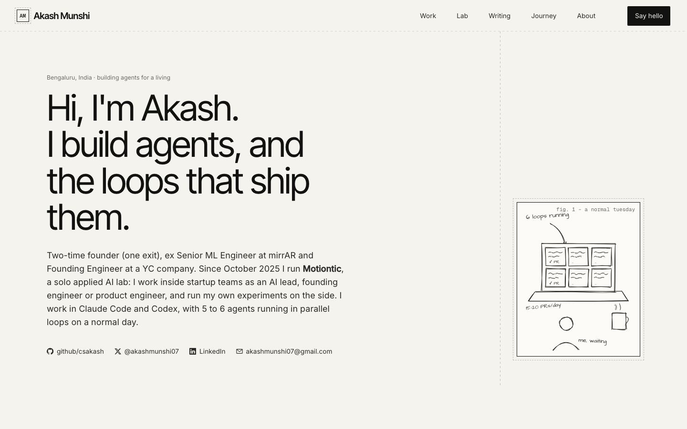

# akashmunshi.com

The personal site of **Akash Munshi**: AI engineer, two-time founder (one exit), and the person behind **Motiontic**, a solo applied AI lab in Bengaluru.



It is one hand-written HTML page. No framework, no build step, no tracking. It started as a shared [Intraface](https://intraface.cc) board, edited by coding agents, and lives here as the version of record.

## What's on the page

| Section | What it holds |
| --- | --- |
| **Hero and numbers** | Who I am, how to reach me, and four numbers I can back |
| **01 · Work** | Motiontic and its clients (Quantum Heaps, PulseCorp, NeevCloud, Bloom Markets, mirrAR), each with my role, then Narrative, mirrAR, Durbin and Quinch |
| **02 · Motiontic lab** | 20 experiments, most active first: ARI-42, GLoop, gstack-loops, Drevon, Intraface, Uno Code and more |
| **03 · Writing** | Essays and guides on building with agents |
| **04 · Journey** | The timeline from 2017 to now |
| **05 · About** | How I work and the communities I run |

## Run it locally

Any static file server works:

```bash
python3 -m http.server 8000 --directory public
```

Then open <http://localhost:8000>. To run it exactly as production does, through the Worker:

```bash
npx wrangler dev
```

## Deploy

The site runs on **Cloudflare Workers** with static assets. `wrangler.jsonc` serves `public/` and attaches the `akashmunshi.com` and `www.akashmunshi.com` custom domains; `src/worker.js` redirects www to the bare domain and hands every other request to the assets.

```bash
npx wrangler deploy
```

The first deploy needs `wrangler login` with access to the Cloudflare account that holds the akashmunshi.com zone. Because `public/` is plain HTML, any other static host works too: point it at `public/` with no build command.

## How it's built

```
public/
  index.html              the whole page: markup, styles and content
  site.js                 header, scroll reveals, number counters and the hero sketch
  vendor/rough-4.6.6.js   rough.js, draws the pencil sketch in the hero
src/worker.js             Cloudflare Worker: www redirect, then serves public/
wrangler.jsonc            Worker config: assets directory and custom domains
docs/screenshot.png       the image at the top of this README
AGENTS.md                 house rules for coding agents (and people) editing the page
```

- **Design.** It shares its palette and type with the Intraface landing page: warm paper background, ink text, dashed hairlines, Inter Tight for headings, Inter for body, Geist Mono for small print. Every colour is a CSS custom property in `:root`.
- **Motion.** Sections fade in as they scroll into view and the hero sketch draws itself in. Anyone who has turned on reduced motion gets everything at once, with nothing animated.
- **Responsive.** The four-column grid collapses to one column under 900px, with no sideways scroll at 375px.
- **No dependencies at runtime** apart from Google Fonts and the vendored rough.js.

## Editing

Content lives in `public/index.html`. Before you change it, read [AGENTS.md](AGENTS.md): it sets the section order, the voice and the design rules, and says what must never go on the page.

## Links

- Site: <https://akashmunshi.com>
- GitHub: [@csakash](https://github.com/csakash)
- X: [@akashmunshi07](https://x.com/akashmunshi07)
- LinkedIn: [akash-munshi](https://www.linkedin.com/in/akash-munshi/)
- Email: <akashmunshi07@gmail.com>

## License

The code (HTML structure, CSS and JavaScript) is MIT licensed: see [LICENSE](LICENSE). The written content, my name and the descriptions of my work are mine; please don't republish them as your own. rough.js is © Preet Shihn, MIT licensed.
